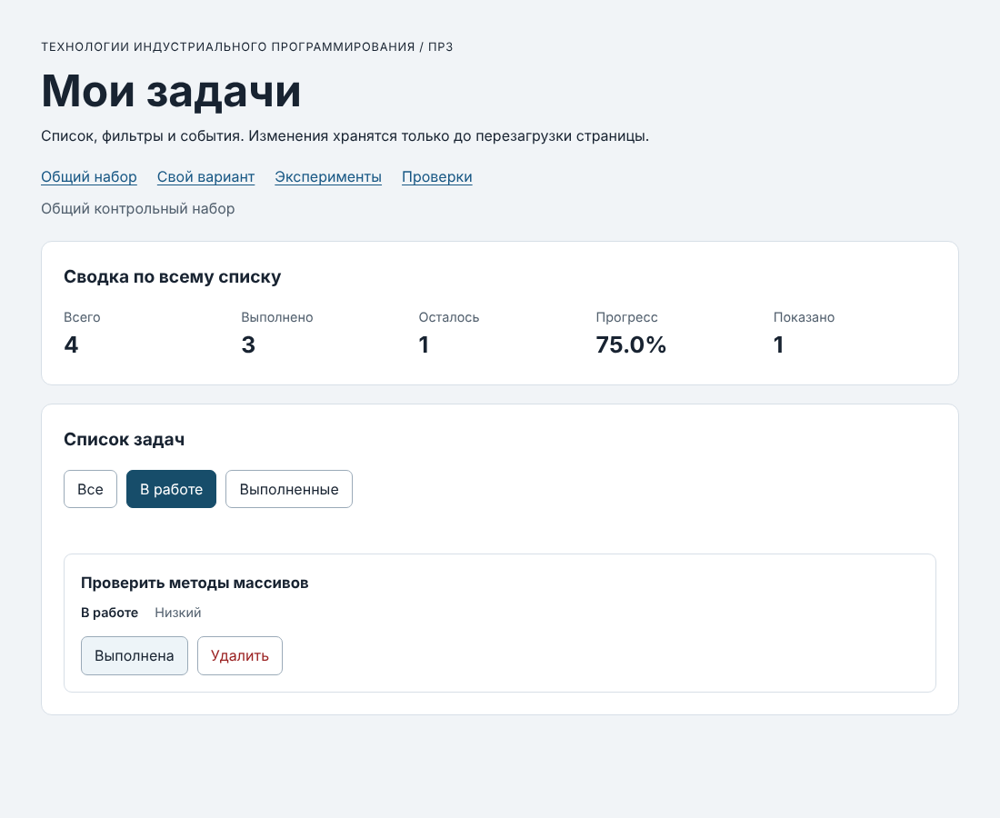
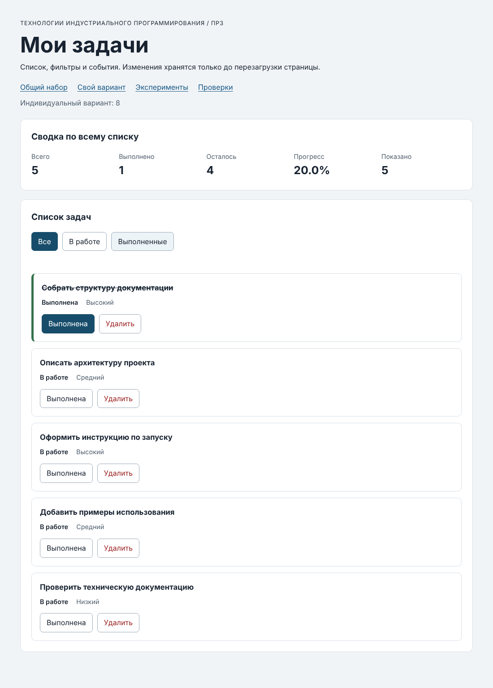

# Практическая работа № 3. Работа с DOM и событиями

## Данные работы

| Поле | Значение |
|---|---|
| Имя | Дружинин Илья |
| Группа | ЭФБО-05-25 |
| Вариант из ПР2 | 8 («Оформление технической документации») |
| Node.js | Заполнить: вывод `node --version` |
| Браузер | Заполнить: название и версия |
| Операционная система | Windows 11 version 25H2 |

## Запуск

Рабочая папка: `practice-03` внутри личного репозитория.

```bash
npm run check:service
npm start
```

Устанавливать зависимости через `npm install` не требуется. Для PowerShell при блокировке `npm.ps1` доступны `npm.cmd` и прямые команды `node`.

```text
http://127.0.0.1:5503/
http://127.0.0.1:5503/index.html?dataset=variant
http://127.0.0.1:5503/examples/dom-events.html
http://127.0.0.1:5503/checks.html
```

Остановка сервера: `Ctrl+C`. Порт по умолчанию (5503) не менялся.

## Что перенесено из ПР2

В `practice-03/src` перенесены собственные файлы из ПР2:

- `task-service.js` — итоговая версия ПР2 с девятью функциями. В неё входят `renameTask` и вспомогательные функции `isValidId`, `normalizeTitle`, `validatePriority`, `findTaskIndex`, которые были добавлены при исправлении ПР2;
- `data.js` — общий набор `demoTasks`, `variantNumber = 8` и шесть задач `variantTasks` (id 11, 23, 37, 41, 58, 64).

Повторная проверка скопированного модуля (`npm run check:service`): 35 пройдено, 0 ошибок (протокол ниже). В `task-service.js` нет обращений к `document`; он остался без DOM-кода.

## Эксперименты

Столбец «До запуска: прогноз» записывается до открытия страницы `examples/dom-events.html`. Ниже в нём оставлено место, остальные столбцы получены при запуске страницы.

| № | До запуска: прогноз | После запуска: результат | Объяснение |
|---:|---|---|---|
| 1. Отсутствующий элемент и коллекция | Заполнить свой прогноз | `document.querySelector("#absent")` даёт `null`; `document.querySelectorAll(".absent").length` даёт `0` | `querySelector` при отсутствии совпадений возвращает `null`, и обращение к его свойствам вызвало бы ошибку. `querySelectorAll` возвращает пустой `NodeList`: это обычный объект, у него есть `length`. |
| 2. dataset и числовой id | Заполнить свой прогноз | `dataset.taskId` — `"23"`, тип `string`; `Number(...)` — `23`, тип `number` | Значения `data-*` всегда строки. В модель ПР2 передаётся число, поэтому преобразование и проверка выполняются на границе обработчика. |
| 3. Статический NodeList | Заполнить свой прогноз | После первого нажатия: старый `NodeList` — 1, новый `querySelectorAll` — 2. После второго: 1 и 3 | `NodeList` из `querySelectorAll` — снимок на момент запроса. Новые элементы в него не попадают, нужен новый запрос. |
| 4. Строка с HTML-разметкой | Заполнить свой прогноз | В заголовке выведена строка `<strong>Это текст, а не HTML</strong>`; дочерних элементов у заголовка: `0` | `textContent` записывает строку как текст, а не разбирает её как HTML, поэтому элемент `strong` не создаётся. |
| 5. Распространение события | Заполнить свой прогноз | Журнал при нажатии на вложенный `span`: см. ниже | см. ниже |

Журнал эксперимента 5 (нажатие по вложенному `span#lab-label`):

```text
1. phase=1; target=lab-label; currentTarget=lab-card
2. phase=3; target=lab-label; currentTarget=lab-button
3. phase=3; target=lab-label; currentTarget=lab-card
```

Объяснение: во всех трёх строках `target` — `span`, то есть исходная цель события. Сначала обработчик контейнера `lab-card` срабатывает в фазе захвата (`phase=1`). Затем событие всплывает: обработчик кнопки `lab-button` вызывается с `phase=3`, потому что цель события — вложенный `span`, а не сама кнопка, а `currentTarget` — тот элемент, на котором сейчас выполняется обработчик. Последним срабатывает обработчик контейнера при всплытии (`phase=3`). Благодаря этому обработчик, назначенный на общий контейнер, получает нажатие на вложенный элемент, и в приложении кнопка ищется через `closest()`.

## Организация кода

| Файл | Ответственность |
|---|---|
| `src/task-service.js` | Прикладные функции ПР2: создание, поиск, статистика, добавление, изменение статуса, переименование, удаление. Возвращают `{ ok, tasks }` или `{ ok: false, error }`; DOM не используют. |
| `src/task-selectors.js` | `getVisibleTasks(tasks, filter)`: возвращает новый массив для `all`, `pending` или `completed` с сохранением порядка и без изменения записей. |
| `src/task-view.js` | Создание и обновление DOM: `createTaskElement`, `renderTaskList`, `renderSummary`, `renderEmptyState`. Всё выводится через `textContent`, `innerHTML` не используется. Состояние не меняется, обработчики не назначаются. |
| `src/main.js` | Состояние (`currentTasks`, `currentFilter`), `renderApp`, обработчики `handleTaskListClick` и `handleFilterClick`. |

Полный список хранится в `currentTasks`, выбранный фильтр — в `currentFilter`. Видимая выборка вычисляется заново в `renderApp` через `getVisibleTasks` и нигде не сохраняется, поэтому фильтр не удаляет записи. События обрабатываются делегированием: по одному обработчику на `ul#task-list` и `div#task-filters`, подписки выполняются один раз вне `renderApp`. Нужная кнопка находится через `closest()`, поэтому нажатие на вложенный `span` тоже работает. Сводка вычисляется функцией `getTaskStats(currentTasks)` по полному массиву (в `renderSummary`), а «Показано» — по длине видимой выборки.

Путь события: клик → `handleTaskListClick` → `closest("button[data-action]")` → `Number(card.dataset.taskId)` и проверка → `findTaskById` (для `toggle`) → `setTaskCompleted` или `removeTask` → проверка `result.ok` → присваивание `currentTasks = result.tasks` → `renderApp()` → `restoreTaskFocus(id, action)`.

## Общий сценарий

Ожидания находятся в разделе 6.5 методички. Ниже записаны фактические результаты запуска.

| Шаг | Видимые id | Всего | Выполнено | Осталось | Прогресс | Показано | Сообщение | Совпало с ожиданием |
|---:|---|---|---|---|---|---|---|---|
| 0 | `[1, 4, 7, 10]` | 4 | 2 | 2 | `50.0%` | 4 | — | Да |
| 1 | `[4, 7]` | 4 | 2 | 2 | `50.0%` | 2 | — | Да |
| 2 | `[7]` | 4 | 3 | 1 | `75.0%` | 1 | — | Да |
| 3 | `[1, 4, 7, 10]` | 4 | 3 | 1 | `75.0%` | 4 | — | Да |
| 4 | `[1, 4, 10]` | 3 | 3 | 0 | `100.0%` | 3 | — | Да |
| 5 | `[]` | 3 | 3 | 0 | `100.0%` | 0 | Нет задач по выбранному фильтру. | Да |
| 6 | `[1, 4, 10]` | 3 | 2 | 1 | `66.7%` | 3 | — | Да |
| 7 | `[]` | 0 | 0 | 0 | `0.0%` | 0 | Список задач пуст. | Да |

После перезагрузки страницы возвращается шаг 0: видимые id `[1, 4, 7, 10]`, сводка `4 / 2 / 2 / 50.0%`. Данные нигде не сохраняются, это ожидаемо для ПР3.

## Индивидуальный вариант

**Тема:** оформление технической документации (вариант 8). Исходные задачи (`variantTasks` в `src/data.js`):

| id | Название | Исходный статус | Приоритет |
|---:|---|---|---|
| 11 | Собрать структуру документации | выполнена | high |
| 23 | Описать архитектуру проекта | выполнена | medium |
| 37 | Подготовить описание API | выполнена | low |
| 41 | Оформить инструкцию по запуску | в работе | high |
| 58 | Добавить примеры использования | в работе | medium |
| 64 | Проверить техническую документацию | в работе | low |

Сценарий выполнен по адресу `index.html?dataset=variant`. Исходные фильтры: «В работе» — `[41, 58, 64]`, «Выполненные» — `[11, 23, 37]`, «Все» — `[11, 23, 37, 41, 58, 64]`. После переключения `id = 23` и удаления `id = 37` итоговые идентификаторы — `[11, 23, 41, 58, 64]`; названия и приоритеты остальных записей не изменились.

| Этап | Всего | Выполнено | Осталось | Прогресс | Видимые id |
|---|---|---|---|---|---|
| До действий (фильтр «Все») | 6 | 3 | 3 | `50.0%` | `[11, 23, 37, 41, 58, 64]` |
| После переключения 23 | 6 | 2 | 4 | `33.3%` | `[11, 23, 37, 41, 58, 64]` |
| После удаления 37 | 5 | 1 | 4 | `20.0%` | `[11, 23, 41, 58, 64]` |
| Итог, фильтр «В работе» | 5 | 1 | 4 | `20.0%` | `[23, 41, 58, 64]` |
| Итог, фильтр «Выполненные» | 5 | 1 | 4 | `20.0%` | `[11]` |

Значения совпадают с контрольной строкой варианта 8 из методички: изначально выполнено 3, после двух действий 1, итоговый прогресс `20.0%`.

## Протокол проверки сервиса

Фактический вывод `npm run check:service`:

```text

> tip-js-practice-03@1.0.0 check:service
> node checks/service.checks.js

OK: 01. Создание задачи с явным приоритетом
OK: 02. Приоритет по умолчанию
OK: 03. Удаление краевых пробелов без изменения внутренних
OK: 04. Граничные длины названия и положительный безопасный id
OK: 05. Некорректные названия при создании
OK: 06. Некорректные идентификаторы при создании
OK: 07. Все допустимые приоритеты и отклонение недопустимых
OK: 08. Каждый вызов createTask возвращает новый объект
OK: 09. Поиск по id, а не по индексу
OK: 10. Отсутствующая задача и пустой массив при поиске
OK: 11. Поиск не преобразует строковый id в число
OK: 12. Получение невыполненных задач
OK: 13. Пустой список, все выполнены и все не выполнены
OK: 14. Названия в исходном порядке и пустой список
OK: 15. Сводка по общему набору
OK: 16. Сводка по пустому списку
OK: 17. Сводка: ничего не выполнено и выполнено всё
OK: 18. Процент остаётся числом без предварительного округления
OK: 19. Добавление в конец без изменения входного массива
OK: 20. Добавление в пустой список с приоритетом по умолчанию
OK: 21. Повторяющийся id отклоняется
OK: 22. Добавление не обходит проверки createTask
OK: 23. Изменение completed в обе стороны
OK: 24. completed принимает только boolean
OK: 25. Некорректный или отсутствующий id при изменении статуса
OK: 26. Повторная установка статуса создаёт новый результат
OK: 27. Переименование сохраняет остальные поля
OK: 28. Проверки названия при переименовании
OK: 29. Некорректный или отсутствующий id при переименовании
OK: 30. Удаление по id с сохранением порядка
OK: 31. Удаление единственной записи
OK: 32. Некорректный, отсутствующий id и удаление из пустого списка
OK: 33. Входные объекты не изменяются ни одной операцией
OK: 34. Общий сценарий и все промежуточные сводки
OK: 35. Работа с другим набором, без зависимости от demoTasks

Проверок пройдено: 35; не пройдено: 0.
```

## Протокол браузерных проверок

Фактический текст из блока «Текстовый протокол» на `checks.html`:

```text
OK: Фильтр all возвращает новый массив в исходном порядке
OK: Фильтр pending выбирает невыполненные задачи
OK: Фильтр completed выбирает выполненные задачи
OK: Все три фильтра работают с пустым списком
OK: Фильтрация не меняет входные записи и их порядок
OK: Карточка — li.task-card с числовым id в dataset
OK: Статус невыполненной карточки и aria-pressed согласованы
OK: Статус выполненной карточки и aria-pressed согласованы
OK: В карточке две обычные кнопки с вложенными подписями
OK: Все приоритеты отображаются по установленному словарю
OK: Название с разметкой отображается текстом
OK: Отрисовка списка создаёт карточки в исходном порядке
OK: Повторная отрисовка не накапливает карточки
OK: Контейнер списка и его обработчик сохраняются
OK: Отрисовка пустого массива очищает прежние карточки
OK: Сводка считается по всему списку, отдельно выводится Показано
OK: Пустая сводка не содержит NaN и Infinity
OK: Сообщение для полностью пустого списка
OK: Сообщение для пустого результата фильтра
OK: Появление карточек скрывает прежнее пустое состояние
OK: Приложение: начальный набор и сводка
OK: Приложение: фильтр срабатывает по клику на вложенный span
OK: Приложение: активный фильтр отмечен классом и aria-pressed
OK: Приложение: фильтрация не удаляет скрытые задачи
OK: Приложение: переключение по id, а не индексу массива
OK: Приложение: выполненная задача исчезает из фильтра В работе
OK: Приложение: удаление изменяет данные, а не только DOM
OK: Приложение: клик по названию не изменяет данные
OK: Приложение: после перерисовок одно нажатие — одно изменение
OK: Приложение: удаление всех записей и нулевая сводка
OK: Приложение: нет совпадений — не то же самое, что нет задач
OK: Приложение: неизвестный числовой id не меняет данные
OK: Приложение: id 4abc не превращается в 4
OK: Приложение: неизвестное действие игнорируется
OK: Приложение: после изменения сохраняется клавиатурный фокус
OK: Приложение: новая загрузка возвращает исходное состояние

Всего: 36. Пройдено: 36. Ошибок: 0.
```

## Собственные проверки

| № | Исходное состояние и действия | Ожидаемый результат | Фактический результат | Итог |
|---:|---|---|---|---|
| 1. Граничное состояние: единственная задача | Общий набор. Удалить `1`, `4`, `7`, остаётся `id = 10` (выполнена). Затем переключить `10`, затем выбрать «Выполненные» | После удаления: `1 / 1 / 0 / 100.0%`. После переключения: `1 / 0 / 1 / 0.0%`. В «Выполненные»: список пуст и сообщение «Нет задач по выбранному фильтру.», а не «Список задач пуст.» | `1 / 1 / 0 / 100.0%`; затем `1 / 0 / 1 / 0.0%`; в «Выполненные»: видимые id `[]`, сообщение «Нет задач по выбранному фильтру.» | Пройдено |
| 2. События и повторная отрисовка: быстрые переключения | Общий набор, фильтр «Все». Пять нажатий подряд на кнопку «Выполнена» у `id = 7`, затем шестое | После пяти нажатий: `id = 7` выполнена, `4 / 3 / 1 / 75.0%`, в списке 4 карточки. После шестого: `4 / 2 / 2 / 50.0%`, 4 карточки | После пяти: `4 / 3 / 1 / 75.0%`, карточек 4. После шести: `4 / 2 / 2 / 50.0%`, карточек 4 | Пройдено |
| 3. Неизменность экспортированного набора | Общий набор. «В работе», отметить `4`, «Все», удалить `7`, переключить `1`. Затем импортировать `demoTasks` из `src/data.js` в той же странице | Интерфейс: видимые id `[1, 4, 10]`, `3 / 2 / 1 / 66.7%`. `demoTasks` остаётся прежним: id `[1, 4, 7, 10]`, `completed` равны `true, false, false, true` | Интерфейс: ``[1, 4, 10]``, `3 / 2 / 1 / 66.7%`. `demoTasks`: id `[1, 4, 7, 10]`, `completed`: `true, false, false, true` | Пройдено |

## Отладка и клавиатура

**Отладка.** Точки останова в `handleTaskListClick` (`src/main.js`) при нажатии на вложенную подпись кнопки «Выполнена» у задачи `id = 4`:

| Строка | Что исследовалось | Значение |
|---:|---|---|
| 64 (`const id = Number(card.dataset.taskId);`) | `event.target` | `SPAN.action-label` (вложенная подпись) |
| | `event.currentTarget` | `task-list` (контейнер списка) |
| | действие | `"toggle"` |
| | `card.dataset.taskId` до преобразования | `"4"`, тип `string` |
| 74 (`const task = findTaskById(...)`) | числовой `id` | `4`, тип `number` |
| | найденная запись до изменения | `{"id":4,"title":"Подготовить модель задач","completed":false,"priority":"high"}` |
| 92 (`currentTasks = result.tasks;`) | `result.ok` | `true` |
| | `result.tasks === currentTasks` | `false` (новый массив) |
| | запись `id = 4` в старом массиве | `{"id":4,"title":"Подготовить модель задач","completed":false,"priority":"high"}` |
| | запись `id = 4` в новом массиве | `{"id":4,"title":"Подготовить модель задач","completed":true,"priority":"high"}` |
| | `result.tasks[1] === currentTasks[1]` | `false` (новый объект) |

Из этого видно, что событие прошло путь от клика до данных: `target` (`span`) → `currentTarget` (`ul`) → строка `"4"` → число `4` → запись из массива → новый массив из `setTaskCompleted` → `renderApp()`.

**Отказы.** Атрибут `data-task-id` одной карточки был изменён сначала на `777`, затем на `4abc` (через `dataset`; то же действие выполняется правкой атрибута в панели Elements).

| Значение id | Действие | Сообщение | Данные |
|---|---|---|---|
| `777` | «Удалить» | «Задача с таким id не найдена» | не изменились: `4 / 2 / 2 / 50.0%` |
| `4abc` | «Выполнена» | «Некорректный идентификатор задачи.» | не изменились: `4 / 2 / 2 / 50.0%` |

`Number("4abc")` даёт `NaN`, поэтому `4abc` не превращается в `4` и сервис не вызывается. После выбора любого фильтра карточки пересоздаются из настоящего массива (id `[1, 4, 7, 10]`), сообщение очищается.

**Клавиатура.** От начала страницы до кнопки «Выполнена» у `id = 4` нужно 10 нажатий Tab (4 ссылки в шапке, 3 кнопки фильтров, 2 кнопки первой карточки, затем кнопка второй карточки). Enter на этой кнопке изменяет статус (`4 / 3 / 1 / 75.0%`), фокус остаётся на той же кнопке задачи `4`. Space возвращает статус (`4 / 2 / 2 / 50.0%`), фокус не теряется. Tab переводит фокус на «Удалить» у `id = 4`, Enter удаляет задачу (id `[1, 7, 10]`), и фокус переходит на активный фильтр «Все», потому что карточки больше нет. Это работает благодаря `restoreTaskFocus`, вызываемой после успешной отрисовки.

## Вид приложения

Скриншоты работающего приложения: общий набор (фильтр «В работе» после отметки `id = 4`) и индивидуальный вариант 8 после переключения `23` и удаления `37`.





## Дополнительное задание

Дополнительное задание не выполнялось.

## Вывод

Задачи из ПР2 отображаются в браузерном интерфейсе: карточки создаются DOM-методами, названия выводятся текстом, а фильтры, сводка и два вида пустого состояния рассчитываются отдельно от полного списка. Действия «Выполнена» и «Удалить» обрабатываются одним делегированным обработчиком на контейнере списка; идентификатор из `dataset` преобразуется в число и проверяется, статус читается из массива, а изменения выполняют функции ПР2.

Главное различие этой работы: изменяются данные, а DOM только отражает их. Удаление `li` из документа не удалило бы задачу, после перерисовки она вернулась бы. Поэтому после каждого успешного действия сохраняется новый массив `result.tasks` и вызывается `renderApp()`, а при отказе сервиса данные остаются прежними.

Пройдены все проверки: 35 проверок сервиса и 36 браузерных, плюс три собственные. При подготовке пришлось завершить функции ПР2 (`renameTask` и вспомогательные функции), так как без них не работали действия интерфейса.
