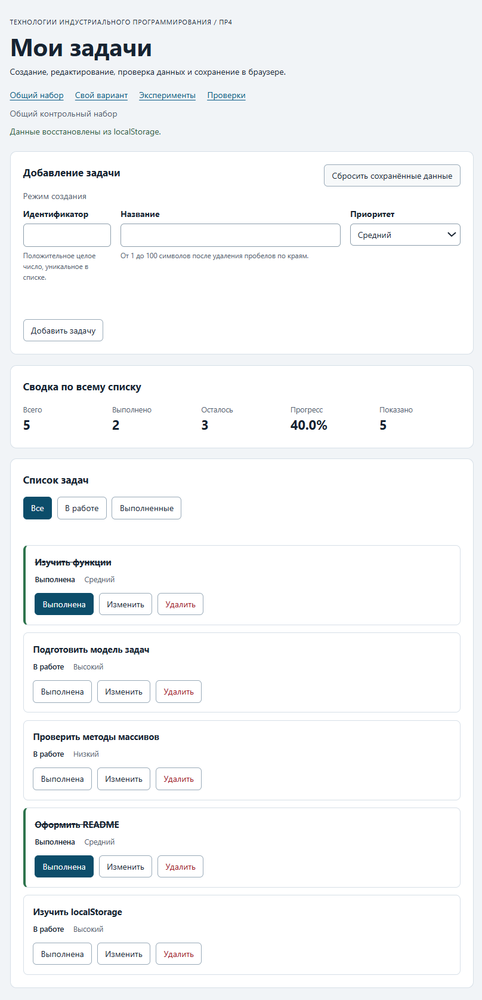
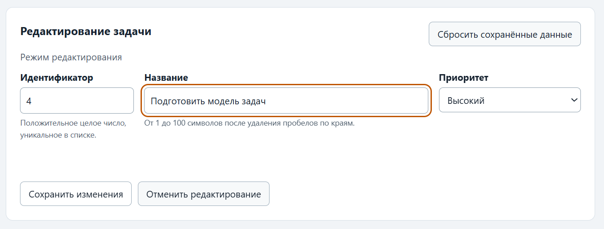
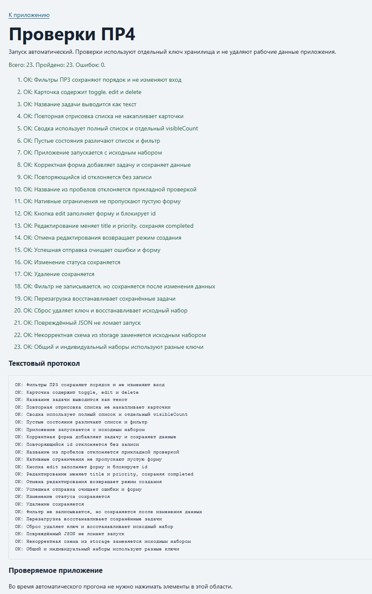
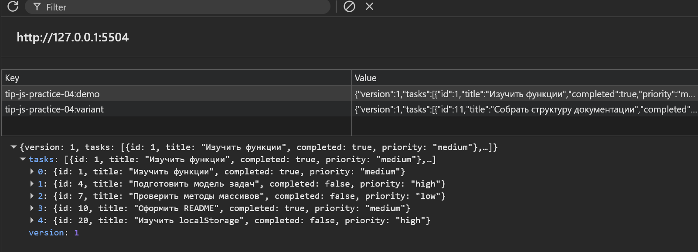

# Практическая работа № 4. Формы, валидация и локальное хранение данных

## Данные работы

| Поле | Значение |
|---|---|
| Имя | Дружинин Илья |
| Группа | ЭФБО-05-25 |
| Вариант из ПР2–ПР3 | 8 |
| Node.js | v24.21.0 |
| Браузер | Firefox 158.0.1 (64-разрядная) |
| Операционная система | Windows 11 25H2 |

## Запуск

Рабочая папка: `practice-04` внутри личного репозитория.

```bash
npm test
npm start
```

Устанавливать зависимости через `npm install` не требуется.

```text
http://127.0.0.1:5504/
http://127.0.0.1:5504/index.html?dataset=variant
http://127.0.0.1:5504/examples/forms-storage.html
http://127.0.0.1:5504/checks.html
```
## Перенос результата ПР3

Указать, какие модули перенесены из ПР3, какие исправления потребовались и какой результат показали повторные проверки сервиса.

| Файл | Что перенесено или изменено |
|---|---|
| `data.js` | Перенесено без изменений |
| `task-service.js` | Перенесено и добавлена функция `updateTask`  |
| `task-selectors.js` | Перенесено без изменений |
| `task-view.js` | Перенесено и добавлена кнопка `edit` в task-card   |

## Эксперименты с формой и хранилищем

| № | До запуска: прогноз | После запуска: результат | Объяснение |
|---:|---|---|---|
| 1. Пустое обязательное поле | Ошибка "Название не должно быть пустым" | Validation error message: "Пожалуйста, заполните это поле "; `submit` не возникает | Нативные ограничения не пропускают пустую форму |
| 2. Название из пробелов | Ошибка: "Название не должно состоять только из пробелов" |  `submit получен, но прикладная проверка отклонила значение` | `required` проверяет что поле не пустое, setCustomValidity() позволяет добавить собственное правило валидации и передать браузеру сообщение об ошибке, чтобы он заблокировал отправку формы до исправления значения |
| 3. Типы значений `FormData` | `string` | `string` | defaultPrevented: `true` |
| 4. Строка в `localStorage` и JSON | Файл корректно прочитается | JSON: `"raw": "{\"title\":\"fg\",\"priority\":\"low\"}"`  | Метод localStorage.setItem() сохраняет данные в виде строк. JSON.stringify() преобразует объект в JSON, а JSON.parse() восстанавливает объект из строки. Метод getItem() возвращает строку или null, если ключ отсутствует. |
| 5. Повреждённый JSON | При попытке разобрать некорректную JSON-строку должна возникнуть ошибка синтаксиса | JSON.parse() завершился ошибкой SyntaxError | Некорректная JSON-строка не может быть преобразована в объект. Поэтому разбор данных необходимо выполнять внутри try...catch. Это позволяет перехватить исключение и обработать ошибку без аварийного завершения приложения | 
## Организация кода

- **`task-service.js`** — содержит основные операции над задачами: создание, поиск, добавление, изменение статуса, переименование, редактирование и удаление. Проверяет корректность данных и возвращает результат операции, не изменяя исходные массивы.
- **`form-validation.js`** — отвечает за прикладную проверку данных формы. Проверяет ID, название и приоритет, удаляет пробелы по краям названия с помощью `trim()` и возвращает объект с ошибками либо проверенными данными.
- **`task-storage.js`** — отвечает за чтение, запись и удаление данных в `localStorage`. Проверяет структуру списка задач, версию хранилища и обрабатывает ошибки доступа и разбора JSON.
- **`task-view.js`** — отвечает за отображение задач: создание карточек, вывод сводки, пустых состояний и списка задач. Не изменяет состояние приложения.
- **`main.js`** — связывает остальные модули. Обрабатывает действия пользователя, управляет состоянием приложения, вызывает проверку формы и операции с задачами, сохраняет изменения и обновляет интерфейс.

Функции хранения получают объект `storage` аргументом, чтобы не зависеть напрямую от глобального `localStorage`. Это позволяет передавать разные реализации хранилища, например тестовый объект, и проверять функции независимо от браузера.

Данные из JSON проверяются до использования, потому что содержимое хранилища может быть повреждено, устареть или иметь неправильную структуру. Проверка версии, типов полей, уникальности ID и допустимых приоритетов предотвращает использование некорректных данных и позволяет безопасно восстановить исходный набор задач.

## Проверка формы

| Сценарий | Ожидаемый результат | Фактический результат | Итог |
|---|---|---|---|
| Добавление корректной задачи | Задача добавляется в список | Задача добавлена, список обновлён | Пройдено |
| Повторяющийся id | Отказ без изменения списка | Повторяющийся ID отклонён, список не изменился | Пройдено |
| Пустое название | Отказ | Форма не отправлена из-за обязательного поля | Пройдено |
| Название из пробелов | Отказ прикладной проверки | `trim()` преобразует название в пустую строку, валидация отклоняет его | Пройдено |
| Название длиной 100 | Успех | Название допустимой длины принято | Пройдено |
| Название длиной 101 | Отказ | Название превышает допустимую длину | Пройдено |
| Редактирование title и priority | Меняется одна задача, статус сохраняется | Название и приоритет изменены, `completed` сохранён | Пройдено |
| Отмена редактирования | Возврат к пустой форме создания | Форма очищена, включён режим создания | Пройдено |

## Общий сценарий

Записать фактические результаты последовательности из раздела 6.8 методички.

| Шаг | Действие | Видимые id | Всего | Выполнено | Осталось | Прогресс | Состояние storage |
|---:|---|---|---:|---:|---:|---:|---|
| 0 | Исходный запуск после сброса | 1, 4, 7, 10 | 4 | 2 | 2 | 50% | Ключ отсутствует |
| 1 | Добавление `id = 20` | 1, 4, 7, 10, 20 | 5 | 2 | 3 | 40% | Задачи сохранены |
| 2 | Отказ для повторного `id = 4` | 1, 4, 7, 10, 20 | 5 | 2 | 3 | 40% | Без изменений |
| 3 | Редактирование `id = 4` | 1, 4, 7, 10, 20 | 5 | 2 | 3 | 40% | Обновлённая задача сохранена |
| 4 | Переключение `id = 7` | 1, 4, 7, 10, 20 | 5 | 3 | 2 | 60% | Новый статус сохранён |
| 5 | Удаление `id = 1` | 4, 7, 10, 20 | 4 | 2 | 2 | 50% | Обновлённый список сохранён |
| 6 | Перезагрузка страницы | 4, 7, 10, 20 | 4 | 2 | 2 | 50% | Данные восстановлены из localStorage |
| 7 | Сброс данных | 1, 4, 7, 10 | 4 | 2 | 2 | 50% | Ключ удалён |


## Проверка восстановления и ошибок

| Случай | Ожидание | Фактический результат | Итог |
|---|---|---|---|
| Записи нет | Используется независимая копия исходного набора | При отсутствии записи загружается исходный набор задач | Пройдено |
| Корректная запись | Данные восстанавливаются после перезагрузки | Сохранённые задачи восстановлены из localStorage | Пройдено |
| Повреждённый JSON | Приложение запускается с исходным набором и предупреждением | Ошибка разбора JSON обработана, приложение использует исходный набор | Пройдено |
| Неверная версия или схема | Исходный набор и предупреждение | Некорректная запись отклонена, используется исходный набор | Пройдено |
| Сброс | Удаляется только ключ текущего набора | Удалён ключ текущего датасета, исходные задачи восстановлены | Пройдено |
| Общий и индивидуальный наборы | Изменения не смешиваются | Для наборов используются разные ключи localStorage | Пройдено |

## Индивидуальный вариант

| ID | Название | completed | Приоритет |
|---:|---|---|---|
| 11 | Собрать структуру документации | true | high |
| 23 | Описать архитектуру проекта | true | medium |
| 37 | Подготовить описание API | true | low |
| 41 | Оформить инструкцию по запуску | false | high|
| 58 | Добавить примеры использования | false | medium |
| 64 | Проверить техническую документацию | false | low |

После сброса добавляется задача 75, редактируется задача 23 и удаляется задача 37.

| Этап | Всего | Выполнено | Осталось | Прогресс | Видимые id |
|---|---:|---:|---:|---:|---|
| Исходный набор | 6 | 3 | 3 | 50% | 11, 23, 37, 41, 58, 64 |
| После добавления 75 | 7 | 3 | 4 | 42,9% | 11, 23, 37, 41, 58, 64, 75 |
| После редактирования 23 | 7 | 3 | 4 | 42,9% | 11, 23, 37, 41, 58, 64, 75 |
| После удаления 37 | 6 | 2 | 4 | 33,3% | 11, 23, 41, 58, 64, 75 |
| После перезагрузки | 6 | 2 | 4 | 33,3% | 11, 23, 41, 58, 64, 75 |
| После сброса | 6 | 3 | 3 | 50% | 11, 23, 37, 41, 58, 64 |

## Протокол проверок сервиса

Реальный вывод `npm run check:service`.

```text
> tip-js-practice-04@1.0.0 check:service
> node checks/service.checks.js

OK: 01. Создание задачи с явным приоритетом
OK: 02. Приоритет по умолчанию
OK: 03. Удаление краевых пробелов без изменения внутренних
OK: 04. Граничные длины названия и положительный безопасный id
OK: 05. Некорректные названия при создании
OK: 06. Некорректные идентификаторы при создании
OK: 07. Все допустимые приоритеты и отклонение недопустимых
OK: 08. Каждый вызов createTask возвращает новый объект
OK: 09. Поиск по id, а не по индексу
OK: 10. Отсутствующая задача и пустой массив при поиске
OK: 11. Поиск не преобразует строковый id в число
OK: 12. Получение невыполненных задач
OK: 13. Пустой список, все выполнены и все не выполнены
OK: 14. Названия в исходном порядке и пустой список
OK: 15. Сводка по общему набору
OK: 16. Сводка по пустому списку
OK: 17. Сводка: ничего не выполнено и выполнено всё
OK: 18. Процент остаётся числом без предварительного округления
OK: 19. Добавление в конец без изменения входного массива
OK: 20. Добавление в пустой список с приоритетом по умолчанию
OK: 21. Повторяющийся id отклоняется
OK: 22. Добавление не обходит проверки createTask
OK: 23. Изменение completed в обе стороны
OK: 24. completed принимает только boolean
OK: 25. Некорректный или отсутствующий id при изменении статуса
OK: 26. Повторная установка статуса создаёт новый результат
OK: 27. Переименование сохраняет остальные поля
OK: 28. Проверки названия при переименовании
OK: 29. Некорректный или отсутствующий id при переименовании
OK: 30. Удаление по id с сохранением порядка
OK: 31. Удаление единственной записи
OK: 32. Некорректный, отсутствующий id и удаление из пустого списка
OK: 33. Входные объекты не изменяются ни одной операцией
OK: 34. Общий сценарий и все промежуточные сводки
OK: 35. Работа с другим набором, без зависимости от demoTasks

Проверок пройдено: 35; не пройдено: 0.
```

## Протокол проверок новых модулей

Реальный вывод `npm run check:modules`.

```text

> tip-js-practice-04@1.0.0 check:modules
> node checks/modules.checks.js

OK: 01. updateTask изменяет название и приоритет выбранной задачи
OK: 02. updateTask нормализует название и сохраняет completed
OK: 03. updateTask не изменяет входной массив и объекты
OK: 04. updateTask отклоняет некорректный и отсутствующий id
OK: 05. updateTask отклоняет некорректные название и приоритет
OK: 06. Валидация создания нормализует поля
OK: 07. Валидация отклоняет некорректные id
OK: 08. Валидация отклоняет повторяющийся id при создании
OK: 09. Валидация проверяет название после trim
OK: 10. Валидация принимает только три приоритета
OK: 11. В режиме редактирования используется editingId
OK: 12. Редактирование отсутствующей задачи отклоняется
OK: 13. Валидация не изменяет draft и список
OK: 14. Проверка схемы принимает корректный список
OK: 15. Проверка схемы отклоняет неверную структуру
OK: 16. Отсутствующая запись возвращает независимую копию исходных данных
OK: 17. Корректная запись восстанавливается из хранилища
OK: 18. Повреждённый JSON приводит к безопасному fallback
OK: 19. Неизвестная версия приводит к безопасному fallback
OK: 20. Некорректные задачи из JSON не принимаются
OK: 21. Ошибка getItem перехватывается
OK: 22. Сохранение записывает версию и задачи
OK: 23. Некорректный список не записывается
OK: 24. Ошибка setItem перехватывается
OK: 25. Удаляется только переданный ключ
OK: 26. Ошибка removeItem перехватывается
OK: 27. Результат загрузки не разделяет объекты с fallback

Проверок пройдено: 27; не пройдено: 0.
```

## Протокол браузерных проверок

Реальный текст из блока «Текстовый протокол» на `checks.html`.

```text
OK: Фильтры ПР3 сохраняют порядок и не изменяют вход
OK: Карточка содержит toggle, edit и delete
OK: Название задачи выводится как текст
OK: Повторная отрисовка списка не накапливает карточки
OK: Сводка использует полный список и отдельный visibleCount
OK: Пустые состояния различают список и фильтр
OK: Приложение запускается с исходным набором
OK: Корректная форма добавляет задачу и сохраняет данные
OK: Повторяющийся id отклоняется без записи
OK: Название из пробелов отклоняется прикладной проверкой
OK: Нативные ограничения не пропускают пустую форму
OK: Кнопка edit заполняет форму и блокирует id
OK: Редактирование меняет title и priority, сохраняя completed
OK: Отмена редактирования возвращает режим создания
OK: Успешная отправка очищает ошибки и форму
OK: Изменение статуса сохраняется
OK: Удаление сохраняется
OK: Фильтр не записывается, но сохраняется после изменения данных
OK: Перезагрузка восстанавливает сохранённые задачи
OK: Сброс удаляет ключ и восстанавливает исходный набор
OK: Повреждённый JSON не ломает запуск
OK: Некорректная схема из storage заменяется исходным набором
OK: Общий и индивидуальный наборы используют разные ключи

```

## Собственные проверки

| № | Исходное состояние и действия | Ожидаемый результат | Фактический результат | Итог |
|---:|---|---|---|---|
| 1 | Ввести название с пробелами по краям: `  Изучить localStorage  ` | Название принимается, пробелы по краям удаляются | Название нормализовано до `Изучить localStorage` | Пройдено |
| 2 | Добавить задачу, перезагрузить страницу | Задача остаётся в списке с прежними полями | Задача восстановлена из localStorage | Пройдено |
| 3 | Поместить некорректный JSON в хранилище и перезагрузить страницу | Приложение запускается с исходным набором и предупреждением | Некорректные данные отклонены, приложение использует исходный набор | Пройдено |

Минимум один случай относится к границе формы, один — к восстановлению после перезагрузки, один — к повреждённым или недоступным данным хранилища.

## Отладка и клавиатура

В ходе отладки была использована точка останова в функции `handleFormSubmit` модуля `main.js`. Проверялись исходные данные формы (`draft`), результат функции `validateTaskDraft`, результат операции сервиса (`result`) и сформированная JSON-строка перед записью в localStorage.

Для проверки клавиатурного управления использовались клавиши Tab, Enter и Space. Клавиша Tab позволяет перемещаться между полями формы и кнопками, Enter — отправлять форму, Space — активировать выбранные кнопки. При переходе к редактированию фокус устанавливается на поле названия, а после отмены редактирования форма возвращается в режим создания.

## Вид приложения

В отчёт добавлены скриншоты собственного запуска приложения:
- Главная страница со списком задач.
- Форма редактирования задачи.
- Результаты проверки в консоли.
- Содержимое localStorage после перезагрузки.

## Дополнительное задание

Не выполнено

## Вывод

В ходе практической работы было разработано приложение для управления списком задач с использованием модульной структуры JavaScript. Ответственность за операции с задачами, проверку формы, хранение данных, отображение интерфейса и управление приложением была распределена между отдельными модулями.

Была реализована прикладная валидация данных формы, включая проверку идентификатора, названия и приоритета. Для хранения данных использовался localStorage с сохранением версии структуры и массива задач в формате JSON. При загрузке данные проверяются, а при обнаружении повреждённой записи или несовместимой версии приложение безопасно возвращается к исходному набору.

В результате работы были проверены операции добавления, редактирования, изменения статуса и удаления задач, фильтрация списка, сохранение и восстановление данных после перезагрузки страницы. Также были рассмотрены обработка ошибок хранилища и клавиатурное управление интерфейсом.

Практическая работа позволила закрепить навыки модульной организации JavaScript-кода, работы с формами, валидации данных, DOM и Web Storage API.